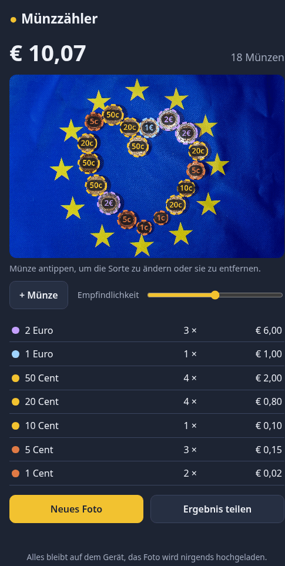
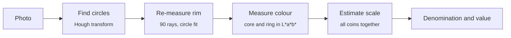

# Münzzähler

Count euro coins from a photo: number of coins and total value, right in the browser.

[](https://github.com/michaelkrisper/muenzen/actions/workflows/ci.yml)
[](https://github.com/michaelkrisper/muenzen/releases)
[](LICENSE)
[](.nvmrc)
[](https://biomejs.dev)
[](https://michaelkrisper.github.io/muenzen/)

**Live: https://michaelkrisper.github.io/muenzen/**

The app finds the coins in the image, determines each denomination and shows
count and total, all on the device without any upload. It is an installable
PWA; the user interface is in German.

<p align="center">
  
</p>

## Features

- **All eight euro coins** from 1 cent to 2 euros, told apart by colour
  (copper, brass, bimetal) and size
- **Total and breakdown** by denomination, shareable as text
- **Correct by tapping:** tap a misclassified coin and choose its
  denomination; the remaining coins are re-evaluated with the new scale
- **Add and remove:** add missed coins with a tap, delete false detections
- **Installable and offline:** after the first visit everything works without
  a network connection
- **Private:** the photo never leaves the device; there is no server and no tracking

## Usage

1. Lay the coins **next to each other** on a plain, matte surface.
2. Photograph them **straight from above** in even light, without flash. The
   app opens the camera on start; without camera permission use the camera
   app or a saved image.
3. Check the result. Dashed circles were detected automatically, solid ones
   were set by hand.
4. If the app reports that the size is ambiguous (e.g. only 10 cent coins),
   fixing a single coin is enough.

On a phone, install the app via _Add to Home Screen_.

## How it works

A photo has no known scale, so the app cannot simply measure millimetres. It
compares the coins with each other instead.



1. **Find circles** ([`detect.js`](detect.js), in a Web Worker): OpenCV.js
   `HoughCircles` with `HOUGH_GRADIENT_ALT`. Overlapping hits are dropped in
   favour of the larger one, so the inner ring of a 2 euro coin does not count
   as a coin of its own.
2. **Re-measure the rim:** Hough gives radii to within a few percent, but
   neighbouring denominations often differ by only 5 %. So the app searches
   the strongest edge along 90 rays and fits a circle through those points
   (Kåsa fit) with an outlier filter.
3. **Measure colour:** median L\*a\*b\* in the core and in the outer ring. The
   median ignores highlights. Hue separates copper from brass; the difference
   between core and ring identifies bimetal coins: 1 euro has a silver core,
   2 euro a silver ring.
4. **Estimate the scale** ([`classify.js`](classify.js)): every combination of
   coin and denomination gives a candidate scale in pixels per millimetre. The
   app picks the one where all coins together best match the
   [official diameters](https://www.ecb.europa.eu/euro/coins/common/html/index.en.html)
   and their colour. With six or more coins the scale may grow linearly across
   the image, which compensates for a tilted phone.
5. **Drop false detections:** circles in skin, pink or blue tones are not
   coins (euro coins are silver, brass or copper coloured). Circles whose size
   fits no denomination, such as buttons, are dropped as well and enter the
   scale search only with a capped cost.
6. **Detect ambiguity:** if a clearly different scale fits almost as well and
   gives a different amount, the app says so.

### Accuracy

| Test material                                                                         | Found                  | Result                              |
| ------------------------------------------------------------------------------------- | ---------------------- | ----------------------------------- |
| Synthetic photos ([`make-fixture.py`](tools/make-fixture.py), 7 seeds, 20 coins each) | 140 / 140              | Exact amount in all 7 photos        |
| Real photos from Wikimedia Commons (2 photos, at an angle, partly crowded)            | 33 / 35                | 24 of 25 determinable coins correct |
| Real photos from Wikimedia Commons (6 photos, on hand, wallet, banknotes, flag)       | 36 / 38, no false hits | 32 of 34 correct                    |

Limits: stacked piles, strong reflections, very dark or colour-cast photos,
and coins of other currencies.

## Project structure

```
index.html, style.css     user interface
app.js                    flow, drawing, corrections
worker.js                 loads OpenCV.js and runs detect.js in the background
detect.js                 circle search, rim refinement, colour measurement
classify.js               metal, scale, denomination, amount (no OpenCV)
sw.js                     service worker for offline use
vendor/opencv.js          OpenCV.js 4.12.0 (Apache-2.0), see vendor/README.md
tests/                    unit tests (node:test) and browser test (headless Chrome)
tools/                    test image generator and evaluation on your own photos
```

No framework and no build step: the files in the repository root are served
as they are.

## Development

Requirements: Node.js 26 (see `.nvmrc`) and Google Chrome. The tools in
`tools/` also need Python 3 with NumPy and ImageMagick.

```sh
npm ci
npm run serve        # http://localhost:8080
```

| Command                                   | Purpose                                                               |
| ----------------------------------------- | --------------------------------------------------------------------- |
| `npm run lint`                            | Biome: formatting and lint for JS, CSS, HTML and JSON                 |
| `npm run lint:fix`                        | the same with automatic fixes                                         |
| `npm test`                                | unit tests for classification and circle detection                    |
| `npm run check`                           | lint + unit tests                                                     |
| `npm run test:e2e`                        | browser test: load photo, check sum, correction and offline cache     |
| `node tools/try.js photo.jpg`             | detection on your own photo, writes `photo.out.jpg` with markings     |
| `node tools/eval.js truth.json`           | hit rate against ground truth (`{"photo.jpg": [[x, y, "50c"], ...]}`) |
| `python3 tools/make-fixture.py out.jpg 7` | synthetic test photo, prints count and amount                         |

[CI](.github/workflows/ci.yml) runs Biome, Ruff, the unit tests and the
browser test on every push and pull request; only when they pass is `main`
published to GitHub Pages. Every merge to `main` is tagged with the next
patch version; bundled releases with release notes come from the Release
workflow. See [CONTRIBUTING.md](CONTRIBUTING.md).

### Browsers

Current versions of Chrome, Edge, Firefox and Safari, iOS 16.4 or newer. The
app needs WebAssembly, Web Workers, `OffscreenCanvas` and `<dialog>`.

## License

[MIT](LICENSE) © Michael Krisper

Bundled: [OpenCV.js](https://opencv.org) under
[Apache-2.0](vendor/LICENSE-opencv.txt). The photo in the screenshot is by
Lukasz Kobus, European Commission,
[CC BY 4.0](https://creativecommons.org/licenses/by/4.0/), via
[Wikimedia Commons](https://commons.wikimedia.org/wiki/File:Euro_coins_(15).jpg).
