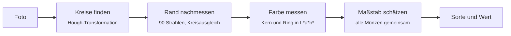

# Münzzähler

[](https://github.com/michaelkrisper/muenzen/actions/workflows/ci.yml)
[](LICENSE)
[](https://biomejs.dev)
[](https://michaelkrisper.github.io/muenzen/)

Euro-Münzen per Foto zählen. Die App findet die Münzen im Bild, bestimmt ihre
Sorte und zeigt Anzahl und Gesamtwert, direkt im Browser und ohne Upload.

**→ [michaelkrisper.github.io/muenzen](https://michaelkrisper.github.io/muenzen/)**

<p align="center">
  
</p>

## Funktionen

- **Alle acht Euro-Münzen** von 1 Cent bis 2 Euro, unterschieden über Farbe
  (Kupfer, Messing, Bimetall) und Größe
- **Gesamtwert und Aufschlüsselung** nach Sorte, als Text teilbar
- **Korrigieren per Antippen**: falsch eingeordnete Münze antippen und Sorte
  wählen; die übrigen Münzen werden mit dem neuen Maßstab neu bewertet
- **Ergänzen und Entfernen**: übersehene Münzen per Fingertipp hinzufügen,
  Fehltreffer löschen
- **Installierbar und offline**: nach dem ersten Besuch läuft alles ohne Netz
- **Privat**: das Foto verlässt das Gerät nicht, es gibt keinen Server und kein Tracking

## Benutzung

1. Münzen **nebeneinander** auf einen einfarbigen, matten Untergrund legen.
2. **Senkrecht von oben** fotografieren, bei gleichmäßigem Licht und ohne Blitz.
   Die App öffnet beim Start gleich die Kamera; ohne Kamera-Erlaubnis geht es
   über die Kamera-App oder ein gespeichertes Bild.
3. Ergebnis prüfen. Gestrichelte Kreise sind automatisch erkannt, durchgezogene
   von Hand festgelegt.
4. Meldet die App, dass die Größe nicht eindeutig ist (etwa bei lauter
   10-Cent-Stücken), genügt es, eine Münze festzulegen.

Auf dem Handy lässt sich die App über *Zum Startbildschirm hinzufügen*
installieren.

## Wie es funktioniert

Ein Foto hat keinen bekannten Maßstab. Die App kann daher nicht einfach
Millimeter messen, sondern vergleicht die Münzen untereinander.



1. **Kreise finden** ([`detect.js`](detect.js), im Web Worker): OpenCV.js
   `HoughCircles` mit `HOUGH_GRADIENT_ALT`. Überlappende Treffer werden
   zugunsten des größeren verworfen, damit der Innenring einer 2-Euro-Münze
   nicht als eigene Münze zählt.
2. **Rand nachmessen**: Hough liefert Radien auf einige Prozent genau. Die
   Größen benachbarter Sorten unterscheiden sich aber oft nur um 5 %.
   Deshalb sucht die App entlang von 90 Strahlen die stärkste Kante und legt
   durch diese Punkte einen Ausgleichskreis (Kåsa), mit Ausreißerfilter.
3. **Farbe messen**: Median von L\*a\*b\* im Kern und im äußeren Ring. Der
   Median ignoriert Glanzlichter. Kupfer und Messing trennt der Farbton,
   Bimetall der Unterschied zwischen Kern und Ring: 1 Euro hat einen silbernen
   Kern, 2 Euro einen silbernen Ring.
4. **Maßstab schätzen** ([`classify.js`](classify.js)): Jede Kombination aus
   Münze und Sorte ergibt einen möglichen Maßstab in Pixel je Millimeter.
   Gewählt wird der, bei dem alle Münzen zusammen am besten zu den
   [offiziellen Durchmessern](https://www.ecb.europa.eu/euro/coins/common/html/index.de.html)
   und ihrer Farbe passen. Ab sechs Münzen darf der Maßstab linear über das
   Bild wachsen, das gleicht ein schräg gehaltenes Handy aus.
5. **Fehltreffer verwerfen**: Kreise in Haut-, Rosa- oder Blautönen sind
   keine Münzen (Euro-Münzen sind silbern, messing- oder kupferfarben). Kreise,
   deren Größe zu keiner Sorte passt, etwa Knöpfe, fallen ebenfalls weg und
   gehen nur gedeckelt in die Maßstabssuche ein.
6. **Mehrdeutigkeit erkennen**: Passt ein deutlich anderer Maßstab fast
   genauso gut und ergibt einen anderen Betrag, weist die App darauf hin.

### Genauigkeit

| Testmaterial | Gefunden | Ergebnis |
|---|---|---|
| Künstliche Fotos ([`make-fixture.py`](tools/make-fixture.py), 7 Seeds, je 20 Münzen) | 140 / 140 | Betrag in allen 7 Fotos exakt |
| Echte Fotos von Wikimedia Commons (2 Fotos, schräg, teils dicht gedrängt) | 33 / 35 | 24 von 25 bestimmbaren Münzen richtig |
| Echte Fotos von Wikimedia Commons (6 Fotos, auf Hand, Geldbörse, Banknoten, Flagge) | 36 / 38, kein Fehltreffer | 32 von 34 richtig |

Grenzen: übereinanderliegende Haufen, starke Spiegelungen, sehr dunkle oder
farbstichige Fotos und Münzen anderer Währungen.

## Projektstruktur

```
index.html, style.css     Oberfläche
app.js                    Ablauf, Zeichnen, Korrekturen
worker.js                 lädt OpenCV.js und ruft detect.js im Hintergrund auf
detect.js                 Kreissuche, Randverfeinerung, Farbmessung
classify.js               Metall, Maßstab, Sorte, Betrag (ohne OpenCV)
sw.js                     Service Worker für den Offline-Betrieb
vendor/opencv.js          OpenCV.js 4.12.0 (Apache-2.0), siehe vendor/README.md
tests/                    Unit-Tests (node:test) und Browsertest (headless Chrome)
tools/                    Testbild-Generator und Auswertung eigener Fotos
```

Kein Framework und kein Build-Schritt: die Dateien im Hauptverzeichnis werden
unverändert ausgeliefert.

## Entwicklung

Voraussetzungen: Node.js 24 und Google Chrome. Für die Werkzeuge in `tools/`
zusätzlich Python 3 mit NumPy und ImageMagick.

```sh
npm ci
npm run serve        # http://localhost:8080
```

| Befehl | Zweck |
|---|---|
| `npm run lint` | Biome: Formatierung und Lint für JS, CSS, HTML und JSON |
| `npm run lint:fix` | dasselbe mit automatischen Korrekturen |
| `npm test` | Unit-Tests für Klassifikation und Kreiserkennung |
| `npm run test:e2e` | Browsertest: Foto laden, Summe prüfen, Korrektur und Offline-Cache testen |
| `node tools/try.js foto.jpg` | Erkennung auf eigenem Foto, schreibt `foto.out.jpg` mit Markierungen |
| `node tools/eval.js truth.json` | Trefferquote gegen Sollwerte (`{"bild.jpg": [[x, y, "50c"], …]}`) |
| `python3 tools/make-fixture.py out.jpg 7` | künstliches Testfoto, gibt Anzahl und Betrag aus |

Die [CI](.github/workflows/ci.yml) führt Biome, Ruff, Unit-Tests und den
Browsertest aus und veröffentlicht `main` danach auf GitHub Pages.
Details in [CONTRIBUTING.md](CONTRIBUTING.md).

### Browser

Aktuelle Versionen von Chrome, Edge, Firefox und Safari, ab iOS 16.4. Die App
braucht WebAssembly, Web Worker, `OffscreenCanvas` und `<dialog>`.

## Lizenz

[MIT](LICENSE) © Michael Krisper

Mitgeliefert: [OpenCV.js](https://opencv.org) unter
[Apache-2.0](vendor/LICENSE-opencv.txt). Das Foto im Screenshot stammt von
Lukasz Kobus, Europäische Kommission,
[CC BY 4.0](https://creativecommons.org/licenses/by/4.0/), über
[Wikimedia Commons](https://commons.wikimedia.org/wiki/File:Euro_coins_(15).jpg).
